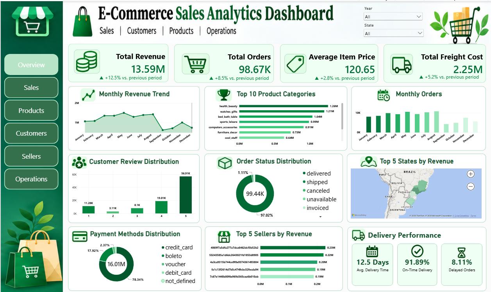
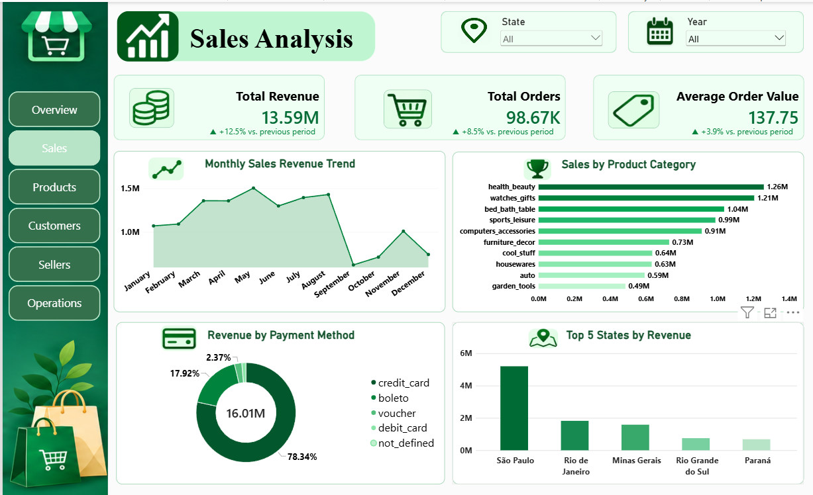
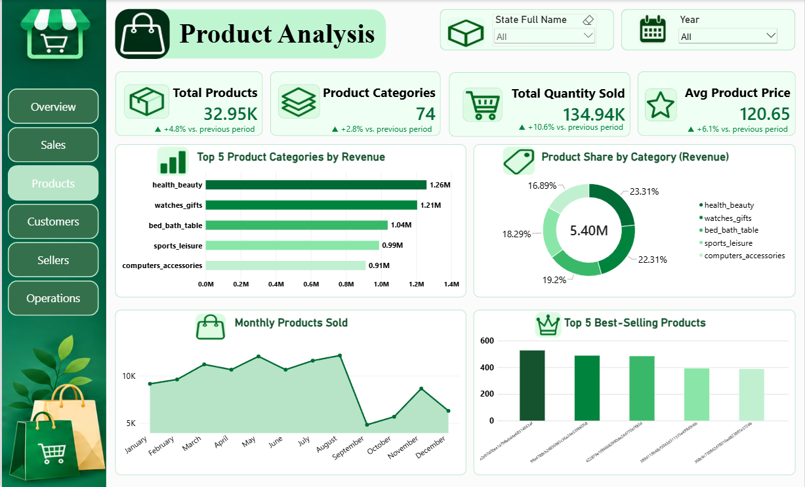
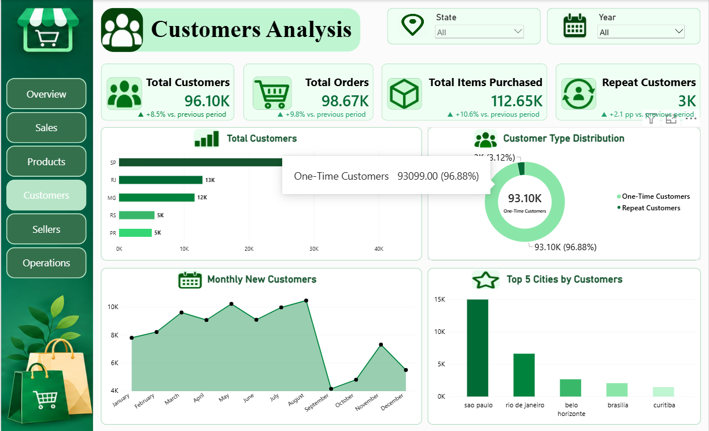
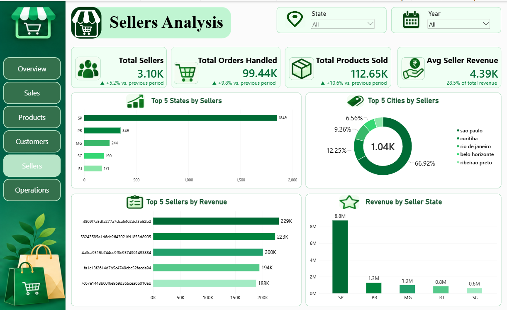
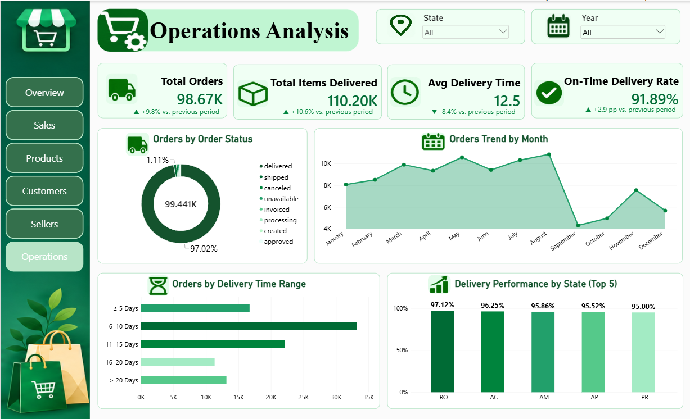

# 📊 Advanced E-Commerce Analytics

An end-to-end Brazilian E-Commerce Data Analytics project using Python, MySQL, SQL and Power BI to analyze business performance and generate actionable insights.

---

## 📌 Project Overview

This project focuses on analyzing the Brazilian E-Commerce Public Dataset by Olist to understand sales performance, customer behavior, product trends, seller performance, payment preferences and delivery operations.

The project follows an end-to-end data analytics workflow involving:

- Data Cleaning and Preprocessing using Python.
- Exploratory Data Analysis (EDA).
- Database Management using MySQL.
- Business Analysis using SQL.
- Data Modeling and DAX using Power BI.
- Interactive Dashboard Development.

---

## 🎯 Project Objectives

- Analyze monthly sales and revenue trends.
- Identify top-performing products and categories.
- Understand customer purchasing behavior.
- Analyze payment method preferences.
- Evaluate customer satisfaction through reviews.
- Measure delivery performance and delays.
- Analyze seller performance.
- Identify high-performing customer states and cities.
- Develop interactive dashboards for business decision-making.

---

## 📂 Dataset

**Dataset Name:** Brazilian E-Commerce Public Dataset by Olist.

The dataset contains 9 CSV files:

1. Customers
2. Geolocation
3. Order Items
4. Order Payments
5. Order Reviews
6. Orders
7. Products
8. Sellers
9. Product Category Translation

The dataset provides information about orders, customers, products, payments, sellers, reviews and delivery operations.

---

## 🛠️ Technologies Used

| Technology | Purpose |
|---|---|
| Python | Data Analysis and Cleaning |
| Pandas | Data Manipulation |
| NumPy | Numerical Operations |
| Matplotlib | Data Visualization |
| Seaborn | Statistical Visualization |
| MySQL | Database Management |
| SQL | Business Data Analysis |
| Power BI | Interactive Dashboards |
| DAX | KPI and Measure Development |
| VS Code | Development Environment |

---

## 🔄 Project Workflow

1. Dataset Inspection
2. Dataset Summary
3. Missing Value Analysis
4. Duplicate Analysis
5. Data Type Analysis
6. Date Analysis
7. Data Cleaning
8. Exploratory Data Analysis
9. MySQL Database Creation
10. SQL Business Analysis
11. Power BI Data Modeling
12. DAX Measure Creation
13. Interactive Dashboard Development

---

# 📊 Power BI Dashboard Screenshots

The project includes six interactive Power BI dashboard pages developed using an Emerald Green and White theme.

## 1. Overview Dashboard

Provides a high-level summary of overall e-commerce business performance through revenue, orders, payment methods, product categories and customer reviews.



## 2. Sales Analysis Dashboard

Analyzes sales performance, monthly revenue trends, product category revenue, payment methods and revenue by customer state.



## 3. Products Analysis Dashboard

Analyzes product performance, product categories, total products sold, average product price and best-selling products.



## 4. Customers Analysis Dashboard

Provides insights into customer distribution, repeat customers, one-time customers, monthly new customers and top customer cities.



## 5. Sellers Analysis Dashboard

Analyzes seller performance, seller distribution by state and city, top-performing sellers and revenue by seller state.



## 6. Operations Analysis Dashboard

Evaluates order status, monthly order trends, delivery time ranges and on-time delivery performance across states.



---

## 🐍 Python Exploratory Data Analysis

Python was used for data inspection, cleaning, preprocessing and exploratory analysis.

### Analysis Performed

- Dataset Inspection
- Dataset Summary
- Missing Value Analysis
- Duplicate Analysis
- Data Type Analysis
- Date Analysis
- Data Cleaning
- Monthly Orders Analysis
- Monthly Revenue Analysis
- Product Category Analysis
- Top 10 Products by Revenue
- Payment Method Distribution
- Review Score Distribution
- Delivery Performance
- Freight Cost Distribution
- Top Customer States
- Monthly Average Order Value
- Monthly Revenue vs Freight Analysis

### Python Visualizations

The generated charts are available in:

`Documentation/Charts/`

---

## 🗄️ MySQL and SQL Analysis

MySQL was used to store and manage the e-commerce dataset.

SQL queries were developed to analyze:

1. Total Revenue
2. Monthly Sales Trends
3. Top Product Categories
4. Payment Method Distribution
5. Customer State Analysis
6. Order Status Analysis
7. Seller Performance
8. Delivery Performance
9. Customer Review Analysis
10. Freight Cost Analysis

SQL Script:

`MySQL/Ecommerce_Analysis.sql`

---

## 📈 Power BI Features

- Six Interactive Dashboard Pages
- KPI Cards
- DAX Measures
- Data Modeling
- Table Relationships
- Interactive State Filters
- Year Filters
- Bar Charts
- Line Charts
- Donut Charts
- Column Charts
- Dashboard Navigation
- Emerald Green and White Theme

Power BI File:

`PowerBI/E-commerce analytics.pbix`

---

## 💡 Key Business Insights

- Identified monthly revenue and order trends.
- Analyzed top-performing product categories.
- Identified popular customer payment methods.
- Evaluated customer satisfaction through review scores.
- Measured average delivery time and on-time delivery rate.
- Identified high-performing sellers.
- Analyzed customer and seller geographic distribution.
- Examined freight costs in relation to product revenue.

---

## 📁 Project Structure

```text
Advanced_Ecommerce_Analytics/
│
├── Dataset/
│   ├── Cleaned/
│   └── Raw/                 (Excluded from GitHub)
│
├── Documentation/
│   ├── Charts/
│   ├── CSV Reports/
│   └── Analysis Reports/
│
├── Images/
│   ├── Overview.png
│   ├── sales.png
│   ├── product.png
│   ├── customer.png
│   ├── seller.png
│   └── operation.png
│
├── MySQL/
│   └── Ecommerce_Analysis.sql
│
├── PowerBI/
│   └── E-commerce analytics.pbix
│
├── Python_EDA/
│   ├── 01_dataset_inspection.py
│   ├── 02_dataset_summary.py
│   ├── 03_missing_values_analysis.py
│   ├── 04_duplicate_analysis.py
│   ├── 05_data_types_analysis.py
│   ├── 06_date_analysis.py
│   ├── 07_data_cleaning.py
│   └── EDA Analysis Scripts
│
├── .gitignore
└── README.md
```

---

## 👩‍💻 Author

**Yoganjana**

GitHub: [yoganjanaLeela-debug](https://github.com/yoganjanaLeela-debug)

---

## ⭐ Project Highlights

This project demonstrates practical skills in:

- Data Analytics
- Python Programming
- Exploratory Data Analysis
- SQL Query Development
- MySQL Database Management
- Power BI Dashboard Development
- Data Visualization
- DAX Calculations
- Business Intelligence
- Data-Driven Decision Making