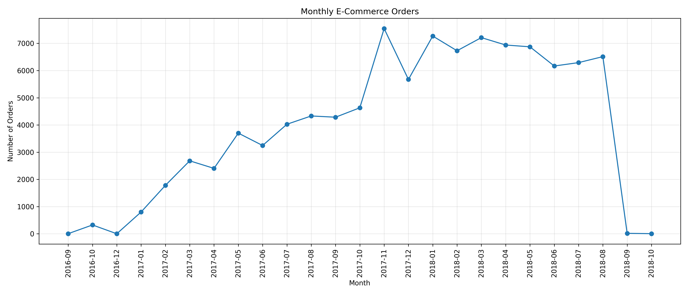
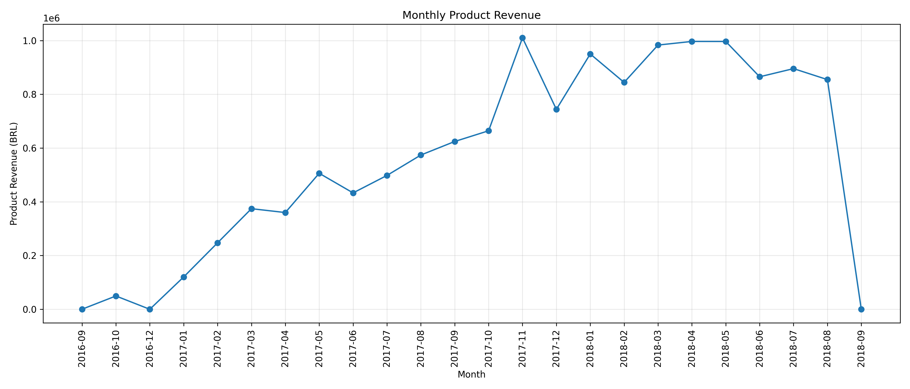
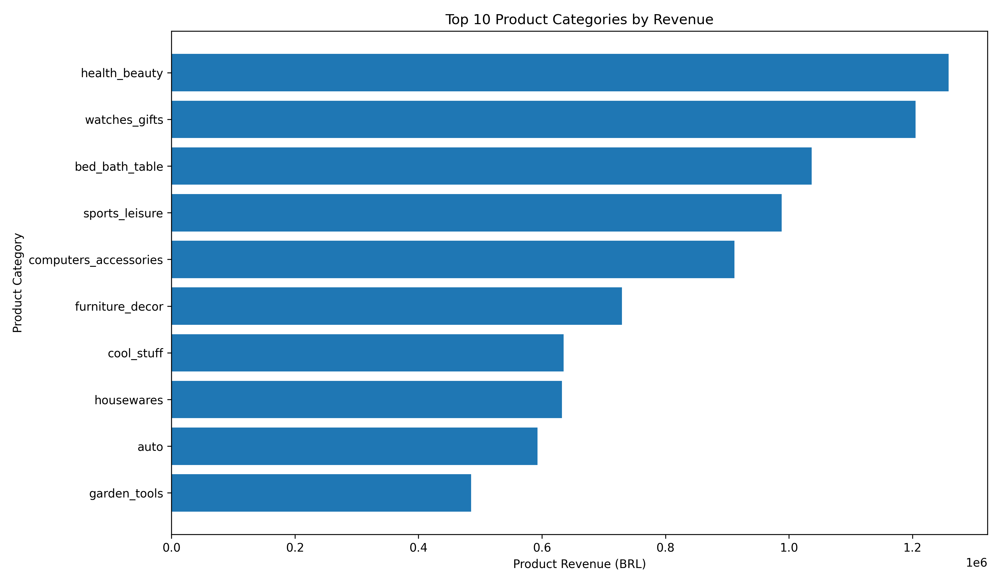
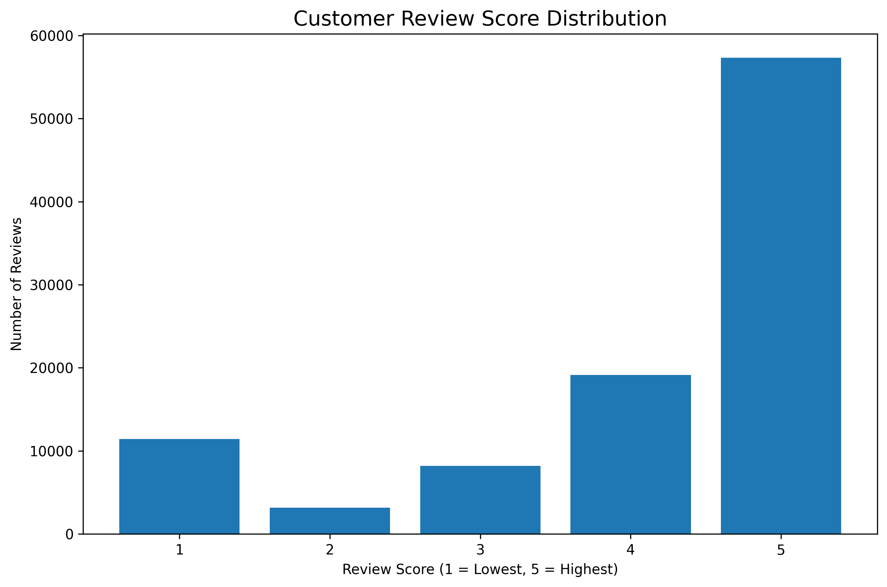
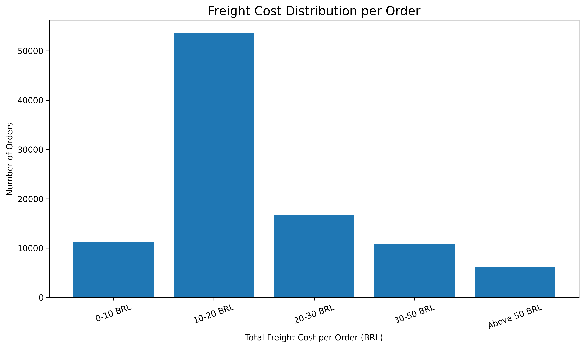
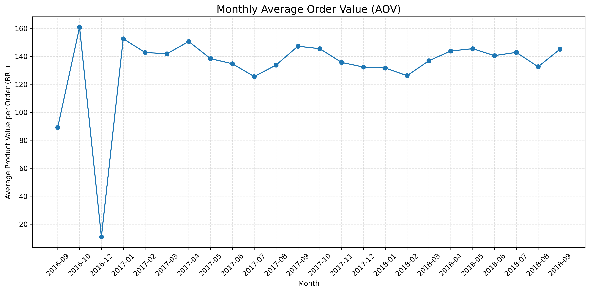
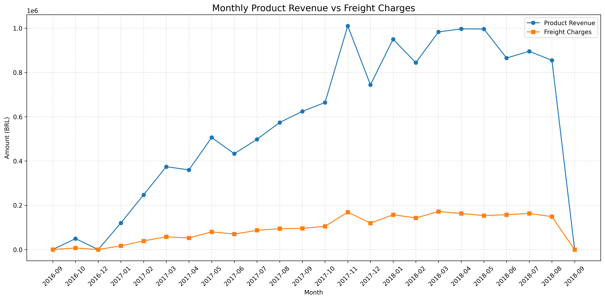

# 📊 Advanced E-Commerce Analytics

An End-to-End Data Analytics Project using Python, MySQL, SQL and Power BI to analyze Brazilian E-Commerce data and generate meaningful business insights.

---

## 📌 1. Project Overview

This project focuses on analyzing the Brazilian E-Commerce Public Dataset by Olist to understand business performance, customer purchasing behavior, sales trends, product performance, seller performance and delivery operations.

The project follows an end-to-end data analytics workflow using Python for data cleaning and exploratory data analysis, MySQL for database management, SQL for business analysis and Power BI for interactive dashboard development.

The main objective is to transform raw e-commerce data into meaningful insights that support business decision-making.

---

## 🎯 2. Project Objectives

- Analyze monthly order and revenue trends.
- Identify top-performing products and categories.
- Understand customer purchasing behavior.
- Analyze customer payment preferences.
- Evaluate customer satisfaction through review scores.
- Measure delivery performance and delays.
- Analyze seller performance.
- Identify high-performing customer states and cities.
- Examine freight costs and shipping patterns.
- Develop interactive dashboards for business insights.

---

## 📂 3. Dataset Description

**Dataset:** Brazilian E-Commerce Public Dataset by Olist.

The dataset contains nine CSV files:

1. Customers Dataset
2. Geolocation Dataset
3. Order Items Dataset
4. Order Payments Dataset
5. Order Reviews Dataset
6. Orders Dataset
7. Products Dataset
8. Sellers Dataset
9. Product Category Translation Dataset

The dataset provides information about customers, orders, products, payments, sellers, reviews, locations and delivery operations.

---

## 🛠️ 4. Technologies Used

| Technology | Purpose |
|---|---|
| Python | Data Analysis and Cleaning |
| Pandas | Data Manipulation |
| NumPy | Numerical Operations |
| Matplotlib | Data Visualization |
| Seaborn | Statistical Visualization |
| MySQL | Database Management |
| SQL | Business Data Analysis |
| Power BI | Interactive Dashboard Development |
| DAX | KPI and Measure Development |
| VS Code | Development Environment |

---

## 🔄 5. Project Workflow

The project was completed through the following stages:

1. Dataset Inspection
2. Dataset Summary
3. Missing Value Analysis
4. Duplicate Analysis
5. Data Type Analysis
6. Date Analysis
7. Data Cleaning and Preprocessing
8. Exploratory Data Analysis (EDA)
9. MySQL Database Creation
10. SQL Business Analysis
11. Power BI Data Modeling
12. DAX Measure Development
13. Interactive Dashboard Development

---

# 🐍 6. Python – Exploratory Data Analysis

Python was used to inspect, clean, transform and analyze the e-commerce dataset.

### Analysis Performed

- Dataset Inspection
- Dataset Summary
- Missing Value Analysis
- Duplicate Analysis
- Data Type Analysis
- Date Analysis
- Data Cleaning
- Monthly Orders Analysis
- Monthly Revenue Analysis
- Product Category Analysis
- Top 10 Products by Revenue
- Payment Method Distribution
- Review Score Distribution
- Delivery Performance
- Freight Cost Distribution
- Top Customer States
- Monthly Average Order Value
- Monthly Revenue vs Freight Analysis

### 📊 Python Data Visualizations

The following visualizations were generated during exploratory data analysis.

### 1. Monthly Orders Trend



### 2. Monthly Revenue Trend



### 3. Top Product Categories



### 4. Payment Method Distribution


### 5. Customer Review Score Distribution



### 6. Delivery Performance


### 7. Freight Cost Distribution



### 8. Top Customer States


### 9. Monthly Average Order Value



### 10. Monthly Revenue vs Freight Charges



### 11. Top 10 Products by Revenue


### 12. Order Status Analysis


---

# 📊 7. Power BI – Interactive Dashboards

Six interactive Power BI dashboard pages were developed using an Emerald Green and White theme.

The dashboards include KPI cards, interactive charts, state and year filters, DAX measures and page navigation.

## 1. Overview Dashboard

Provides a high-level summary of overall e-commerce business performance, including revenue, orders, product categories, payment methods, customer reviews and delivery performance.


## 2. Sales Analysis Dashboard

Analyzes sales performance, monthly revenue trends, product category revenue, payment methods and revenue by customer state.


## 3. Products Analysis Dashboard

Analyzes product performance, product categories, total products sold, average product price and best-selling products.


## 4. Customers Analysis Dashboard

Provides insights into customer distribution, repeat customers, one-time customers, monthly new customers and top customer cities.


## 5. Sellers Analysis Dashboard

Analyzes seller performance, seller distribution by state and city, top-performing sellers and revenue by seller state.


## 6. Operations Analysis Dashboard

Evaluates order status, monthly order trends, delivery time ranges and on-time delivery performance across states.


### Power BI Features

- Six Interactive Dashboard Pages
- KPI Cards
- DAX Measures
- Data Modeling and Relationships
- State and Year Filters
- Bar Charts
- Line Charts
- Donut Charts
- Column Charts
- Dashboard Navigation
- Business Performance Analysis

---

# 🗄️ 8. MySQL and SQL Analysis

MySQL was used to store and manage the e-commerce dataset.

SQL queries were developed to analyze:

1. Total Revenue
2. Monthly Sales Trends
3. Top Product Categories
4. Payment Method Distribution
5. Customer State Analysis
6. Order Status Analysis
7. Seller Performance
8. Delivery Performance
9. Customer Review Analysis
10. Freight Cost Analysis

**SQL Script:** `MySQL/Ecommerce_Analysis.sql`

---

# 💡 9. Key Business Insights

The analysis helped identify the following business insights:

- Identified monthly revenue and order trends.
- Analyzed top-performing product categories.
- Evaluated customer payment preferences.
- Examined customer satisfaction through review scores.
- Measured delivery performance and delivery delays.
- Identified high-performing sellers.
- Analyzed customer and seller geographic distribution.
- Examined freight costs in relation to product revenue.

---

# 📁 10. Project Structure

```text
Advanced_Ecommerce_Analytics/
│
├── Dataset/
│   ├── Raw/                  (Excluded from GitHub)
│   └── Cleaned/
│
├── Documentation/
│   ├── Charts/
│   └── Analysis Reports/
│
├── Images/
│   ├── Overview.png
│   ├── sales.png
│   ├── product.png
│   ├── customer.png
│   ├── seller.png
│   └── operation.png
│
├── MySQL/
│   └── Ecommerce_Analysis.sql
│
├── PowerBI/
│   └── E-commerce analytics.pbix
│
├── Python_EDA/
│   ├── 01_dataset_inspection.py
│   ├── 02_dataset_summary.py
│   ├── 03_missing_values_analysis.py
│   ├── 04_duplicate_analysis.py
│   ├── 05_data_types_analysis.py
│   ├── 06_date_analysis.py
│   ├── 07_data_cleaning.py
│   └── Other EDA Scripts
│
├── .gitignore
└── README.md
```

---

# 🚀 11. How to Run the Project

### Python

1. Clone the repository.
2. Install the required Python libraries.
3. Place the Olist dataset files in the appropriate dataset folder.
4. Run the Python EDA scripts.

### MySQL

1. Install MySQL.
2. Create the `olist_ecommerce` database.
3. Import the required dataset tables.
4. Execute the SQL analysis script.

### Power BI

1. Open the `.pbix` file using Power BI Desktop.
2. Configure the MySQL connection if required.
3. Refresh the data.
4. Explore the six interactive dashboard pages.

---

# 👩‍💻 12. Author

**Yoganjana**

GitHub: [yoganjanaLeela-debug](https://github.com/yoganjanaLeela-debug)

---

## ⭐ Project Highlights

This project demonstrates practical skills in:

- Data Analytics
- Python Programming
- Exploratory Data Analysis
- SQL Query Development
- MySQL Database Management
- Power BI Dashboard Development
- DAX Calculations
- Data Visualization
- Business Intelligence
- Data-Driven Decision Making