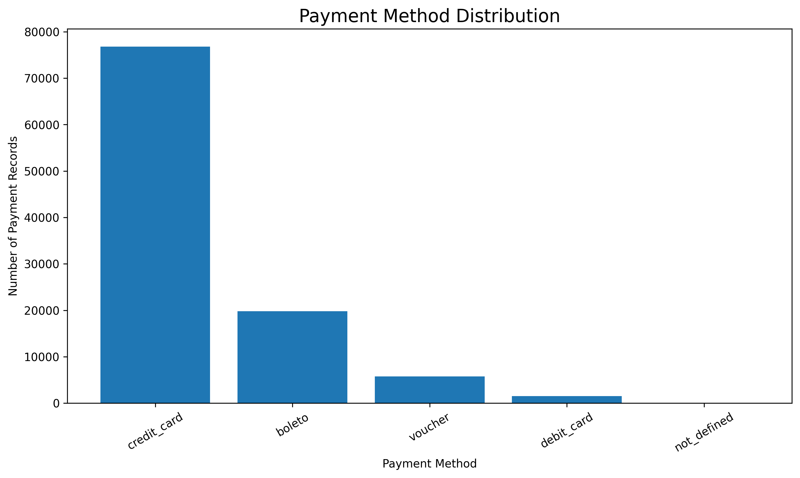
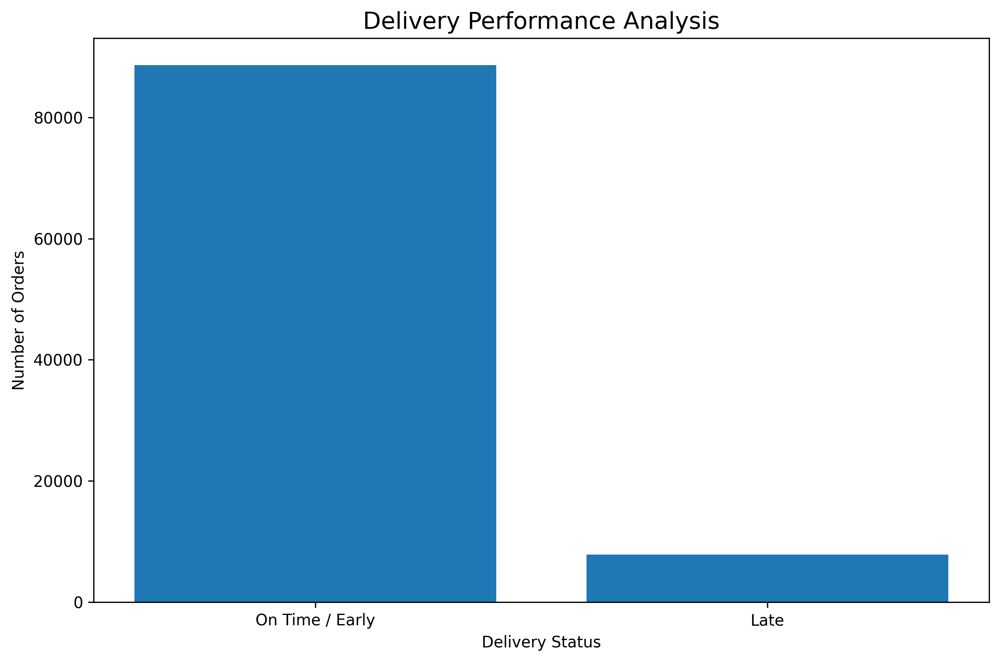
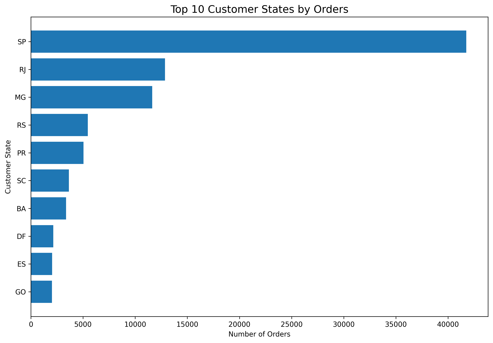
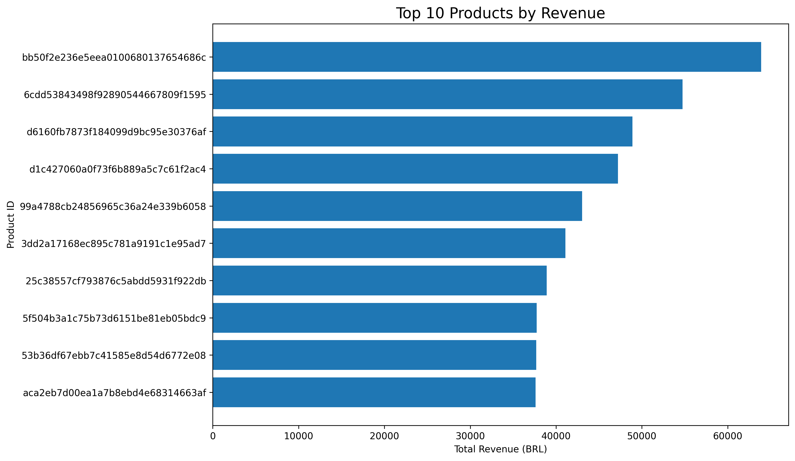
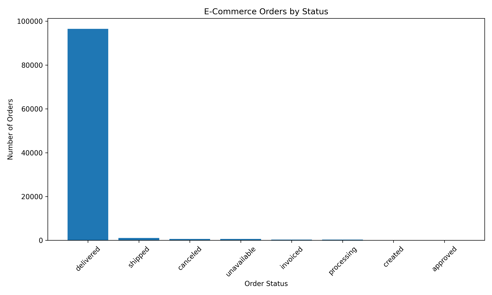

# 📊 Advanced E-Commerce Analytics

## 📌 Project Overview

This project focuses on analyzing Brazilian e-commerce data to
identify sales trends, customer behavior, payment preferences,
product performance, and delivery patterns.

Python is used to perform data cleaning, exploratory data analysis
(EDA), visualization, and business reporting.

## 🎯 Project Objectives

- Analyze monthly order and revenue trends.
- Identify top-performing products and categories.
- Understand customer payment preferences.
- Evaluate customer review scores.
- Analyze delivery performance.
- Examine shipping costs and customer locations.
- Generate meaningful business insights from e-commerce data.

## 📂 Dataset

The project uses the Brazilian E-Commerce Public Dataset by Olist.

The dataset contains information about orders, customers, products,
payments, reviews, sellers, and geolocation.

## 🛠️ Technologies Used

- Python
- Pandas
- NumPy
- Matplotlib
- Seaborn
- Visual Studio Code

## 📈 Analysis and Visualizations

The project includes the following visualizations:

## 📊 Project Visualizations

### 1. Monthly Orders Trend


### 2. Monthly Revenue Trend


### 3. Top Product Categories


### 4. Payment Method Distribution


### 5. Customer Review Score Distribution


### 6. Delivery Performance


### 7. Freight Cost Distribution


### 8. Top Customer States


### 9. Monthly Average Order Value


### 10. Monthly Revenue vs Freight Charges


### 11. Top 10 Products by Revenue


### 12. Order Status Analysis


## 📁 Project Structure

```text
Advanced_Ecommerce_Analytics/
├── Dataset/
│   ├── Raw/
│   └── Cleaned/
├── Python_EDA/
├── Documentation/
│   └── Charts/
└── README.md

## 👩‍💻 Author

Yoganjana
